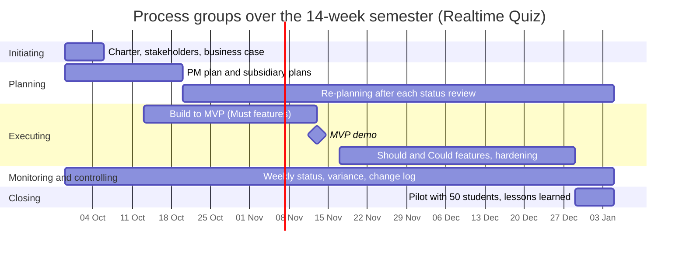

# Process groups over the semester

| Process group | Weeks active | Main activities | Outputs | Lab that produces them |
|---------------|--------------|-----------------|---------|------------------------|
| Initiating | 1 | Write the charter, identify stakeholders, justify the investment | Charter, stakeholder list, business case | Lab-01 |
| Planning | 1-3, then re-planning 4-14 | Scope, schedule, budget and risk plans; re-plan after each status review | Project plan and subsidiary plans, updated baselines | Lab-01 starts it; later planning labs add the plans |
| Executing | 3-13 | Build to the MVP by week 7, then Should and Could features and hardening | Working increments, MVP demo, tagged builds | Every lab (practice) |
| Monitoring and controlling | 1-14 | Weekly status meeting, schedule and cost variance, risk review, change requests | Status reports, change log, updated baselines | Every lab (practice) |
| Closing | 14 | Pilot with 50 students, hand-over to IT operations, lessons learned | Pilot report, accepted deliverables, lessons-learned document | Closing lab |

## Process groups over the semester

## Phase gates
At the **week-1 gate** the sponsor decides whether to start: the evidence is the signed charter and the business case with its payback. At the **week-7 gate** the sponsor decides to continue, change or stop: the evidence is the MVP demo passing all Must features live; if it fails, the review gate in the business case switches to option B for next semester. At the **week-13 pilot-readiness gate** the sponsor decides whether the pilot may go ahead: the evidence is a load test with 100 simulated students passing, the data approval received and the runbook handed to IT operations. These gates apply the continued business justification idea from PRINCE2.